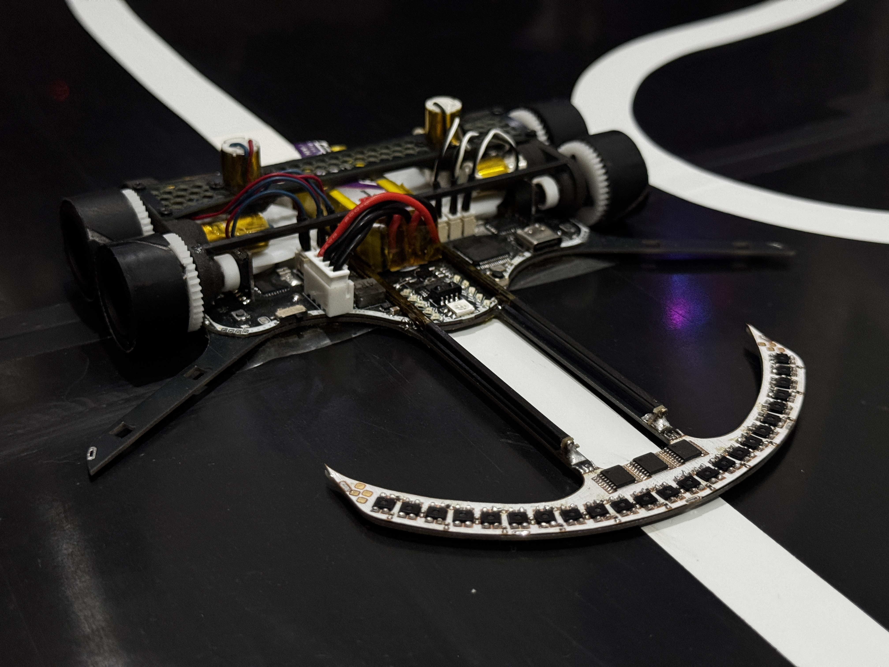
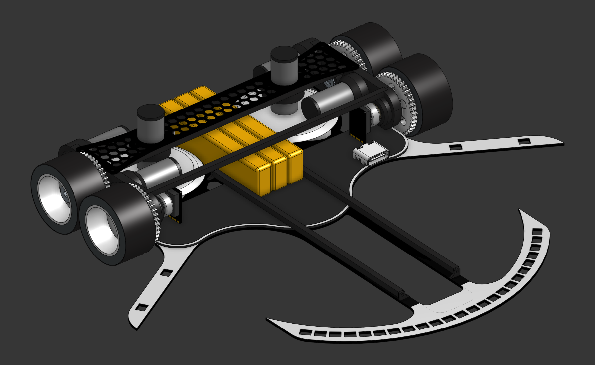

# DragonBot2

Robot **siguelíneas tipo Robotracer** de alto rendimiento para competir en la **All Japan Robotracer 2027**. Basado en un **STM32F405 @168 MHz**, con **24 sensores de línea** multiplexados, **tracción tetra** con 4 motores coreless, encoders magnéticos de alta resolución, **succión** y un **EKF de odometría** de 6 estados, todo con registro de datos a bordo y herramientas de análisis offline.

## 🎯 Objetivo

Desarrollar un robotracer competitivo para la **All Japan Robotracer 2027**. El firmware contempla tres modos de competición:

- **Linefollower**
- **Robotracer**
- **Drag race**

## 🏆 Palmarés

Todavía en desarrollo — **sin resultados de competición por el momento**.

| 🥇 | 🥈 | 🥉 |
| --- | --- | --- |
| **0** | **0** | **0** |

### Resultados por Evento

| Evento | Categoría | Posición | Año |
| --- | --- | --- | --- |
| _Pendiente_ | — | — | — |

---

## ⚙️ Hardware

- **Microcontrolador**: STM32F405RGT6 @168 MHz (LQFP-64)
- **Driver de motores**: 2× MP6615 (puente H con sensado de corriente bidireccional integrado)
- **IMU**: LSM6DSR (giroscopio, 1000/2000/4000 dps)
- **Encoders**: 2× AS5145B-HSST magnéticos de 12 bits (leídos en cuadratura ×4 por hardware → 4096 cuentas/vuelta)
- **Sensores de línea**: 24× ITR8307 (reflectivos) leídos a través de 3× multiplexores CD4051B
- **Sensores de marca**: 4× ITR8307 (laterales, para *landmarks* del robotracer)
- **Sensor de presión**: BMP280
- **Memoria externa**: SRAM SPI 23AA04M-I/ST de 512 KB + EEPROM en la flash interna del MCU
- **Receptor infrarrojo**: TSSP77038TR (38 kHz, mando RC5)
- **Regulador**: DC-DC conmutado CN3903 + LDO
- **Mosfet de succión**: BUK9Q20-40H
- **LEDs**: 1× LED RGB 5050, 10 LEDs de información, 1 LED de estado
- **Batería**: LiPo 3S (11,1–12,6 V), fabricada a partir de 3 celdas 1S de 300 mAh; conector JST-XH de 4 pines
- **Conectores de motores**: Hirose DF13 a 1,25 mm
- **Interfaz**: USB-C (ST-Link + USART3)

### Tracción

- **Tracción tetra**: 2 ruedas por lado, con **4 motores coreless de 7.4v** (2 por lado)
- **Reducción**: piñón de 8 dientes → engranaje de 40 dientes (**5:1**)
- **Ruedas**: Ø≈23 mm, con llanta impresa en PLA, una capa de espuma gruesa y una lámina de silicona exterior de gran adherencia
- **Succión**: doble ventilador centrífugo para aumentar el agarre a alta velocidad, usando **2 motores coreless de 7.4v**

### PCBs

El repositorio incluye dos placas diseñadas en KiCad (proyecto, gerbers y BOM):

- **Main**: MCU, drivers, sensores, encoders, memoria y regulación.
- **Chasis**: placa de chasis con pads de interconexión y switch de alimentación.

### Pinout (resumen)

| Función | Periférico / Pin |
| --- | --- |
| PWM motores | TIM1 CH1–CH4 (PA8–PA11) |
| Encoders | TIM3 (PB4/PB5), TIM4 (PB6/PB7) |
| Succión / RGB | TIM8 CH1–CH4 (PC6–PC9) |
| Sensores de línea | ADC1 IN10–IN12 (PC0–PC2) + selección de mux (PC13–PC15) |
| Sensores de marca / corriente de motor | ADC2 IN0–IN5 (PA0–PA5) |
| Tensión de batería | ADC2 IN13 (PC3) |
| IMU / BMP280 / SRAM | SPI3 (PC10–PC12) |
| Mando IR 38 kHz | EXTI12 (PA12) |
| Serie / ST-Link | USART3 (PB10/PB11) |

## 💻 Software

- Programado en **VSCode + PlatformIO** con **libopencm3**. Flasheo y depuración por **ST-Link**.
- **Scheduler** con **SysTick a 8 kHz** repartido en 8 slots → cada tarea corre a **1 kHz**.
- Todas las señales analógicas se leen por **DMA** (ADC1 y ADC2).
- Los **sensores de línea** se leen a través de los 3 multiplexores; la posición sobre la línea (rango ±1000) se calcula por media ponderada, con filtro de ventana **Bigger Filtro** y **detección automática del color de la línea** (blanca/negra).
- Los **encoders** se leen en **cuadratura por hardware** (TIM3/TIM4), con resolución de overflow por máxima verosimilitud.
- La **IMU** se lee por SPI con *data-ready*; el LSM6DSR se configura a ODR 833 Hz **sin filtro hardware** (medida cruda para el estimador).
- **Odometría con EKF de 6 estados** `[x, y, θ, v, ω, bias_gyro]`, con `dt` real medido por DWT, **ZUPT** y **detección de derrape**.
- **Lazo de control a 1 kHz** con PID de velocidad lineal y PID de posición de línea (angular) que reparte la tensión entre las ruedas, con **compensación de la tensión de batería**.
- **Estrategias de velocidad**: `SPEED_TEST`, `SPEED_NORMAL`, `SPEED_MEDIUM`, `SPEED_FAST`, `SPEED_SUPER` y `SPEED_HAKI` (2000–4000 mm/s), con ganancias escaladas ∝ 1/v.
- **Menú** de configuración y de *run* por LEDs, manejable con botones y con **mando RC5**; los parámetros se persisten en EEPROM.
- **Calibraciones**: offset del giroscopio, sensores, separación de ruedas (girando 2π con el gyro), escala de rueda (distancia patrón) y escalón de rotación (test T1).
- **Registro a bordo**: log en la **SRAM SPI de 512 KB** (ring en RAM + volcado diferido en los slots del SysTick), volcado por serie para análisis offline.

### Herramientas de análisis (`source_code/tools/`)

- `line_control_tuner.py` — métricas y predicción de ganancias del lazo de línea.
- `linear_speed_analyzer.py` — análisis del lazo de velocidad lineal y *feedforward*.
- `parse_odometry_log.py` — parseo y gráficas del log de odometría.

### Documentación técnica interna (`.features/`)

- `odometry/ROADMAP.md` — odometría y EKF.
- `pid_tuning/ROADMAP.md` — tuning del control de velocidad y de línea.
- `linear_speed/linear_speed_analysis_and_plan.md` — análisis del lazo lineal.

## 🎥 Vídeos

https://github.com/user-attachments/assets/3e48b05f-021b-4ee5-92f5-90e260f31eb7

## 📄 Licencia

Distribuido bajo la **PolyForm Noncommercial License 1.0.0**. Ver [LICENSE](LICENSE).
